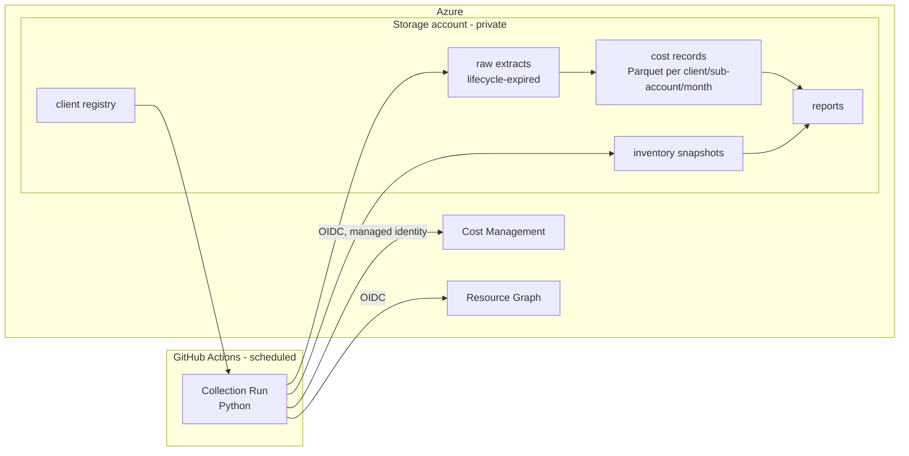

# CostOps

Multi-cloud cost visibility for people who administer cloud environments: automated collection of cost and inventory data, a normalized history you own, scheduled reports, and cost anomaly detection. Azure first; OCI and GCP next.

> 🚧 **Status: planning complete (M0), implementation starting.** v0.1.0 is a reference implementation and learning lab, not a validated product. See [Roadmap](#roadmap).

## Problem

Administering several cloud environments makes simple questions hard to answer: what exists, what does it cost, what grew since last month, and what looks wrong. Each provider has its own console and billing format, so consolidation is usually manual.

Native tools (Azure Cost Management anomaly alerts, budgets, scheduled e-mails) answer these questions **for one provider at a time**. CostOps aims at **multi-cloud consolidation** and a **cost history owned by the operator**.

The problem is currently a **hypothesis**; it is being validated outside the code in parallel with development.

## What v0.1.0 does

CostOps is an **internal, self-hosted tool** run by one operator over the cloud environments of one or more clients. SaaS is explicitly out of scope ([ADR-0001](docs/adr/0001-internal-single-operator-tool-not-saas.md)).

- Collects **daily cost data** and an **inventory snapshot** from declared Azure subscriptions.
- Normalizes cost into a **subset of [FinOps FOCUS](https://focus.finops.org/)** ([ADR-0002](docs/adr/0002-focus-subset-as-cost-record-model.md)).
- Keeps an idempotent **history**, re-collecting until the provider's data is final ([ADR-0003](docs/adr/0003-idempotency-by-partition-replacement.md)).
- Produces a **report** per client: freshness, month-to-date vs previous month, top changes, anomalies, inventory/cost mismatches.
- Detects **cost anomalies** with a robust statistical baseline (median/MAD with a minimum absolute amount).
- Runs **on a schedule**, with no stored secrets.

Out of scope for v0.1.0: idle-resource detection, cost allocation between clients, currency conversion, dashboards, active notifications.

**Done means:** a scheduled job collects real data from a study subscription, history accumulates without duplication, a report is generated, and an anomaly injected into a synthetic dataset is detected.

## Architecture

- **Runtime:** scheduled GitHub Actions workflow ([ADR-0005](docs/adr/0005-scheduled-github-actions-as-runtime.md)).
- **Identity:** user-assigned managed identity federated to a GitHub Environment; Reader on the subscription; data-plane roles granted per container, read-only on the Client Registry (`config`) and write on `raw`, `cost-records`, `inventory` and `reports` ([ADR-0006](docs/adr/0006-identity-and-least-privilege.md)).
- **Storage:** partitioned Parquet in Blob Storage, queried in-process with DuckDB; no database server ([ADR-0004](docs/adr/0004-partitioned-parquet-in-blob-queried-with-duckdb.md)).
- **Infrastructure:** Terraform with remote state; `apply` is manual; a subscription budget guards spend ([ADR-0007](docs/adr/0007-terraform-remote-state-and-manual-apply.md)).
- **Provider isolation:** each provider's collector is the only code that knows that provider's format; everything downstream speaks FOCUS.
- **Pending:** the Azure cost collection mechanism (Exports vs Query API) is decided by a hands-on spike in M1.

## Security principles

- No secrets anywhere: OIDC workload identity federation; storage shared keys disabled.
- Least privilege: read-only cost and inventory access; storage writes granted per container and never to the Client Registry ([ADR-0006](docs/adr/0006-identity-and-least-privilege.md)); CI cannot create resources or assign roles.
- Public repository, private data: no cost data, subscription IDs or resource names in code, logs or workflow artifacts. Tests use a deterministic **synthetic dataset**.
- Storage reachable over its public endpoint but authenticated by Entra ID only ([ADR-0008](docs/adr/0008-public-storage-endpoint-with-entra-only-auth.md)).
- AI agents assist with code and docs but never touch cloud resources or real data ([agent boundaries](docs/agents/boundaries.md)).

## Stack

| Concern | Choice |
|---|---|
| Language | Python |
| Azure access | Azure Identity SDK, Cost Management, Resource Graph |
| Data model | FOCUS subset |
| Storage / query | Parquet in Azure Blob Storage, DuckDB |
| Infrastructure | Terraform (azurerm, remote state in Azure Storage) |
| Automation | GitHub Actions with OIDC |
| Quality | pytest, Ruff |

## Roadmap

Planned at ~4 hours/week alongside AZ-104 exam preparation. Dates are targets.

| Milestone | Goal | Target |
|---|---|---|
| M0 | Planning & architecture | 2026-12-06 |
| M1 | Foundations & access: repo, CI, security baseline, manual Azure setup, collection spike | 2026-12-20 |
| M2 | Local walking skeleton: real cost → FOCUS → Parquet → minimal report | 2027-01-10 |
| M3 | Synthetic dataset, history, idempotency | 2027-01-24 |
| M4 | Automation: Terraform + scheduled OIDC workflow | 2027-02-07 |
| — | AZ-104 exam pause | end of Feb 2027 |
| M5 | Inventory snapshot, mismatches, full report | 2027-03-14 |
| M6 | Cost anomaly detection | 2027-03-28 |
| M7 | Release v0.1.0 | 2027-04-04 |
| M8+ | Second provider (OCI likely first), informed by problem validation | TBD |

## Documentation

- [Glossary](GLOSSARY.md): the project's domain language
- [Architecture decision records](docs/adr/)
- [Product brief](docs/discovery/product-brief.md): scope, rules and roadmap rationale
- [Open questions and risks](docs/discovery/open-questions.md)
- [Research notes on cost APIs](docs/discovery/research-cost-apis.md)

## Author

Reinaldo Luiz da Silva — [LinkedIn](https://www.linkedin.com/in/reinaldoluizdasilva) · [GitHub](https://github.com/ReinaldoLuizSilva)
